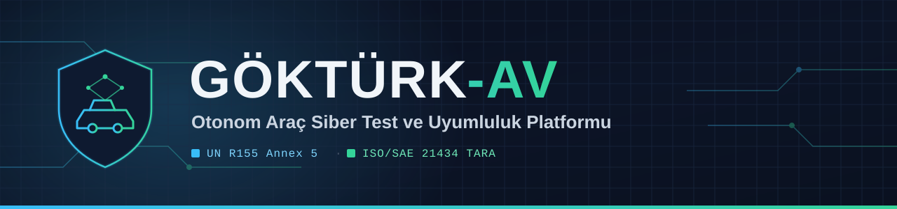

<div align="center">



<br/>

[](https://www.python.org/)
[](https://streamlit.io/)
[](https://www.sqlite.org/)
[](docs/coverage_roadmap.md)
[-22c55e?style=flat-square)](docs/coverage_roadmap.md)
[](#test-modules)
[](https://github.com/GokturkFK/gokturk-av)
[](https://github.com/GokturkFK)

**End-to-end cybersecurity testing, ISO/SAE 21434 TARA risk assessment, and UN R155 compliance reporting for autonomous shuttles and buses.**

</div>

---

## Overview

**GÖKTÜRK-AV** is a modular cybersecurity testing and compliance platform engineered for Level 4 autonomous buses and shuttles. It evaluates the entire vehicle attack surface—from in-vehicle CAN buses and ROS2/DDS perception stacks to OTA update pipelines and fleet backend servers—anchored directly to all **69 vectors of UN R155 Annex 5**, transforming findings into **ISO/SAE 21434 TARA** risk assessments, automated `.docx` audit reports, and a live compliance heatmap.

The core engine never hardcodes a specific vehicle model: onboarding a new vehicle requires only a declarative YAML profile, and the adapter layer lets identical test plugins run unchanged across both mock environments and live CAN/ROS2/CARLA labs.

---

## Highlights

<table>
<tr>
<td width="50%" valign="top">

### Red Team · Attack Simulation

- CAN bus replay, fuzzing & DoS injection
- ROS2/DDS unauthenticated topic discovery & injection
- V2X message spoofing & V2I trust abuse
- GPS/GNSS, LiDAR & sensor spoofing + Adversarial ML
- ECU firmware fuzzing, extraction & Secure Boot checks
- OTA / firmware update pipeline attacks
- Fleet backend & cloud BOLA API security
- Diagnostic (OBD-II/UDS) & physical debug port (JTAG/UART) checks

</td>
<td width="50%" valign="top">

### Blue Team · Compliance & Reporting

- Interactive 3D vehicle attack-surface map
- Live **UN R155 Annex 5** compliance heatmap (69 cells)
- Automated **ISO/SAE 21434 TARA** generation
- Automatic finding → regulatory vector anchoring
- One-click `.docx` compliance audit report export
- Dark/light theme Streamlit operations console
- Realistic Level 4 autonomous shuttle reference profile

</td>
</tr>
</table>

---

## UN R155 Annex 5 Coverage

<div align="center">

</div>

**55 / 69 UN R155 Annex 5 vectors** are covered by executable test modules—representing **100% of all software-reachable vectors (55/55)** across **all 7 threat categories**. The remaining 14 vectors require physical hardware/lab equipment (oscilloscopes, SDR, chip-off tooling).

📄 [Coverage Roadmap →](docs/coverage_roadmap.md) · [TARA Document →](docs/tara.md) · [Field Research →](docs/saha-arastirmasi.md)

---

## Test Modules

29 declarative test plugins anchored to UN R155 Annex 5 vectors, executing seamlessly across mock and real vehicle adapters:

| R155 Vector(s) | Module | Scope | File |
| :--- | :--- | :--- | :--- |
| `R155-1.1..1.5` | Backend Server Security | Weak auth, privilege abuse, unauthorized access, supply chain, DoS | `backend_server_plugin.py` |
| `R155-2.2` | CAN Fuzzing | Frame injection (CAN / Automotive Ethernet) | `can_fuzz_plugin.py` |
| `R155-2.3,2.6` | Channel Interception | Eavesdropping / sniffing & Man-in-the-Middle | `comm_interception_plugin.py` |
| `R155-2.4` | CAN Bus DoS | Bus flooding & denial of service | `can_dos_plugin.py` |
| `R155-2.5` | CAN Replay | Frame replay attack | `can_replay_plugin.py` |
| `R155-2.1,2.7,5.12` | V2X Manipulation | Unsigned BSM injection, spoofing, V2I trust abuse | `v2x_spoof_plugin.py` |
| `R155-2.8` | GPS/GNSS Spoofing | Navigation & positioning spoofing | `gps_spoof_plugin.py` |
| `R155-2.9` | LiDAR Spoofing | Perception sensor spoofing (LiDAR / camera / radar) | `lidar_spoof_plugin.py` |
| `R155-2.11,2.13` | Wireless RF Interfaces | Cellular jamming & DSRC/802.11p protocol abuse | `wireless_rf_plugin.py` |
| `R155-3.1..3.7` | OTA / Firmware Update Attacks | Build tampering, channel DoS, signature bypass, rollback, manifest | `ota_attack_plugin.py` |
| `R155-4.1,4.3,4.5` | Human & Organizational Factors | Phishing controls, secure defaults, change management | `human_factor_plugin.py` |
| `R155-4.2` | Diagnostic Access Abuse | Misuse of legitimate diagnostic sessions | `diag_access_abuse_plugin.py` |
| `R155-4.4,5.2,5.3` | External Device Access | Bluetooth pairing, USB autorun, fleet device policy | `external_device_access_plugin.py` |
| `R155-5.1` | Telematics Channel Exploitation | Cellular / Wi-Fi telematics attack surface | `telematics_channel_plugin.py` |
| `R155-5.4` | IVI / Infotainment Pivot | Lateral movement from IVI into vehicle networks | `ivi_pivot_plugin.py` |
| `R155-5.5` | OBD-II / UDS Enumeration | Diagnostic service discovery & abuse | `obd2_enum_plugin.py` |
| `R155-5.6` | ROS2/DDS Topic Discovery | Unauthenticated ROS2/DDS topic enumeration | `ros2_topic_enum_plugin.py` |
| `R155-5.7` | ROS2/DDS Message Injection | Malicious topic publishing & state manipulation | `ros2_topic_injection_plugin.py` |
| `R155-5.9,5.10` | Connected App Layer | Mobile companion API & 3rd-party IVI privilege escalation | `app_layer_plugin.py` |
| `R155-5.11` | Vehicle-to-Cloud API | Cross-vehicle Broken Object Level Authorization (BOLA) | `cloud_api_plugin.py` |
| `R155-5.13` | Remote Telematics Exploit | Remote exploitation of telematics units | `remote_telematics_exploit_plugin.py` |
| `R155-6.1,6.4,6.13` | Firmware & Software Integrity | Tampering, integrity violations, Secure Boot bypass | `firmware_integrity_plugin.py` |
| `R155-6.2,6.5` | Firmware Extraction / RE | Key extraction & ECU firmware reverse engineering | `firmware_extraction_plugin.py` |
| `R155-6.3,6.10` | In-Vehicle Personal Data | Data exfiltration in transit & unauthorized access at rest | `personal_data_plugin.py` |
| `R155-6.7` | Adversarial ML | Perception model manipulation | `adversarial_ml_plugin.py` |
| `R155-6.8,6.9` | ECU Firmware Fuzzing | Memory corruption & race/logic flaws | `ecu_fuzz_plugin.py` |
| `R155-6.11,6.12,6.14` | System Integrity & Isolation | EDR/black-box tampering, supply chain, container/hypervisor escape | `system_integrity_plugin.py` |
| `R155-7.1` | Unauthorized Physical ECU Access | Physical ECU tampering controls | `physical_ecu_access_plugin.py` |
| `R155-7.4` | Physical Debug Port Access | JTAG / UART debug interface exposure | `debug_port_access_plugin.py` |

---

## Quickstart

> Requirement: **Python ≥ 3.10**

```bash
# 1. Virtual environment
python3 -m venv venv
source venv/bin/activate        # Windows: venv\Scripts\activate

# 2. Install dependencies
pip install -r requirements.txt

# 3. Environment configuration
cp .env.example .env            # Windows: copy .env.example .env
```

### Linux Virtual CAN Lab (`vcan0` + `can-utils`)

```bash
chmod +x lab_setup.sh && ./lab_setup.sh
```

### Launch Streamlit Console & Generate TARA

```bash
# Start compliance & testing dashboard
streamlit run ui/app.py

# Generate ISO/SAE 21434 TARA document
python scripts/generate_tara.py > docs/tara.md

# Run test suite
pytest
```

---

## Project Structure

```text
gokturk-av/
├── core/         # Core engine (finding store, orchestrator, reporting, 3D map, heatmap)
├── adapters/     # Vehicle connectivity adapters (SocketCAN, mock, CARLA)
├── plugins/      # 29 UN R155-anchored attack & compliance test modules
├── taxonomy/     # UN R155 Annex 5 taxonomy (69 vectors, 7 categories)
├── profiles/     # Declarative YAML vehicle profiles & schema docs
├── scripts/      # Automated TARA generator
├── ui/           # Streamlit console (Vehicle, Attack Surface, Test, Findings, Compliance, Report)
├── docs/         # TARA report, coverage roadmap, field research, SVG assets
└── tests/        # Automated test suite (pytest)
```

---

## Architectural Philosophy

| Principle | Description |
| :--- | :--- |
| **Vehicle-Agnostic Core** | The orchestration engine has zero hardcoded knowledge of specific vehicle models. |
| **Pluggable Adapters** | Adding a vehicle or bus protocol requires only a new adapter; switching mock ↔ live leaves plugin code untouched. |
| **Declarative Profiles** | Extending coverage to new fleets or shuttle architectures requires only YAML configuration. |
| **Taxonomy-Anchored Findings** | Every finding is anchored to an R155 vector; reports are generated automatically. |

---

## Documentation

- 🗺️ [Coverage Roadmap](docs/coverage_roadmap.md) — live status of all 69 vectors
- 📋 [TARA Document](docs/tara.md) — ISO/SAE 21434 risk assessment
- 🔬 [Field Research](docs/saha-arastirmasi.md) — threat model and background

---

## Contributing

| Role | Responsibility |
| :--- | :--- |
| **Security** | Test modules, TARA, finding analysis, research |
| **DevOps** | CI/CD, Docker, environment management, backups, releases |

---

<div align="center">
  <sub>Developed by <a href="https://github.com/GokturkFK">GokturkFK</a> · Automotive Cybersecurity Suite</sub>
</div>
