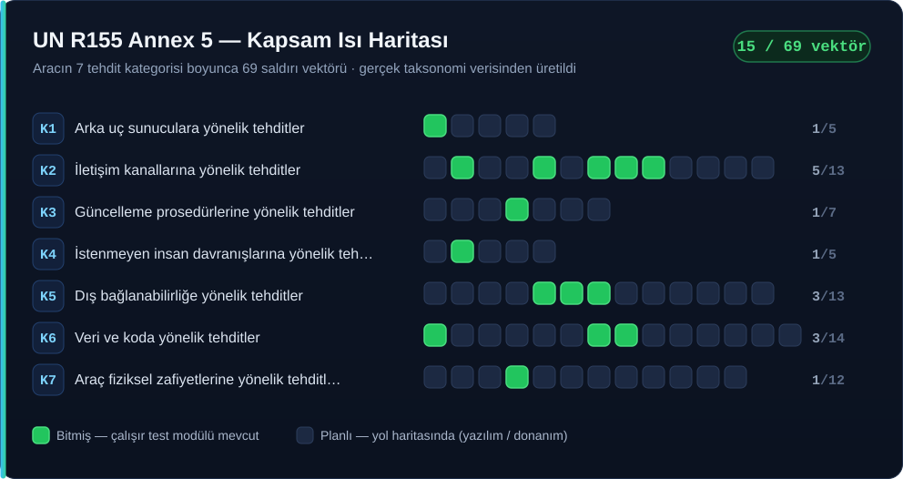

<div align="center">


<br/>

[](https://www.python.org/)
[](https://streamlit.io/)
[](https://www.sqlite.org/)
[](docs/coverage_roadmap.md)
[-22c55e?style=flat-square)](docs/coverage_roadmap.md)
[](#test-modülleri)
[](https://github.com/GokturkFK/gokturk-av)
[](https://github.com/GokturkFK)

**Otonom otobüs/shuttle araçları için uçtan uca siber güvenlik testi, ISO/SAE 21434 TARA risk değerlendirmesi ve UN R155 uyumluluk raporlaması.**

**🇹🇷 Türkçe** · [🇬🇧 English](#-english)

</div>

---

## Genel Bakış

**GÖKTÜRK-AV**, Seviye 4 otonom otobüs ve shuttle sınıfı araçlar için geliştirilmiş modüler bir siber güvenlik testi ve uyumluluk platformudur. Aracın CAN ağından ROS2/DDS algı yığınına, OTA güncelleme kanalından filo backend sunucularına kadar tüm saldırı yüzeyini **UN R155 Annex 5'in 69 vektörüne** çapalı olarak test eder; bulguları **ISO/SAE 21434 TARA** risk değerlendirmesine, otomatik `.docx` denetim raporuna ve canlı uyumluluk ısı haritasına dönüştürür.

Çekirdek motor hiçbir araç modelini doğrudan tanımaz: yeni bir araç yalnızca deklaratif bir YAML profili gerektirir ve adaptör katmanı sayesinde aynı test modülleri hem mock ortamda hem gerçek CAN/ROS2/CARLA laboratuvarlarında **değişmeden** çalışır.

---

## Öne Çıkanlar

<table>
<tr>
<td width="50%" valign="top">

### 🔴 Kırmızı Takım · Saldırı Simülasyonu

- CAN replay, fuzzing ve DoS mesaj enjeksiyonu
- ROS2/DDS kimliksiz topic keşfi ve enjeksiyonu
- V2X mesaj manipülasyonu ve V2I güven istismarı
- GPS/GNSS, LiDAR ve sensör spoofing + Adversarial ML
- ECU firmware fuzzing, çıkarma ve Secure Boot kontrolleri
- OTA / firmware güncelleme hattı saldırıları
- Backend / filo sunucu ve bulut BOLA API güvenliği
- Teşhis (OBD-II/UDS) ve fiziksel debug portu (JTAG/UART) testleri

</td>
<td width="50%" valign="top">

### 🔵 Mavi Takım · Uyumluluk & Raporlama

- 3D interaktif araç saldırı yüzeyi haritası
- Canlı **UN R155 Annex 5** uyumluluk ısı haritası (69 hücre)
- Otomatik **ISO/SAE 21434 TARA** üretimi
- Bulgu → mevzuat vektörü otomatik çapalama
- Tek tıkla `.docx` denetim raporu dışa aktarımı
- Koyu/açık tema destekli Streamlit operasyon panosu
- Gerçekçi Seviye 4 otonom shuttle referans profili

</td>
</tr>
</table>

---

## UN R155 Annex 5 Kapsam Durumu

<div align="center">

</div>

**55 / 69 UN R155 Annex 5 vektörü** çalışır test modülleriyle kapsanmaktadır — bu, **yazılımla ulaşılabilir tüm vektörlerin (%100, 55/55)** ve **7 tehdit kategorisinin tamamının** kapsandığı anlamına gelir. Kalan 14 vektör fiziksel laboratuvar donanımı (osiloskop, SDR, chip-off vb.) gerektirir.

📄 [Kapsam Yol Haritası →](docs/coverage_roadmap.md) · [TARA Belgesi →](docs/tara.md) · [Saha Araştırması →](docs/saha-arastirmasi.md)

---

## Test Modülleri

29 deklaratif test modülü, UN R155 Annex 5 vektörlerine çapalı olarak mock ↔ gerçek adaptörlerde değişmeden çalışır:

| R155 Vektörü | Modül | Kapsam | Dosya |
| :--- | :--- | :--- | :--- |
| `R155-1.1..1.5` | Arka Uç Sunucu Güvenliği | Zayıf kimlik doğrulama, hak suistimali, yetkisiz erişim, tedarik zinciri, DoS | `backend_server_plugin.py` |
| `R155-2.2` | CAN Fuzzing | Mesaj enjeksiyonu (CAN / Otomotiv Ethernet) | `can_fuzz_plugin.py` |
| `R155-2.3,2.6` | Kanal Dinleme / MitM | Bilgi dinleme ve ortadaki adam saldırısı | `comm_interception_plugin.py` |
| `R155-2.4` | CAN Bus DoS | Bus taşması ve servis engelleme | `can_dos_plugin.py` |
| `R155-2.5` | CAN Replay | Çerçeve tekrar oynatma saldırısı | `can_replay_plugin.py` |
| `R155-2.1,2.7,5.12` | V2X Manipülasyonu | İmzasız BSM enjeksiyonu, kimlik taklidi, V2I güven istismarı | `v2x_spoof_plugin.py` |
| `R155-2.8` | GPS/GNSS Spoofing | Konum ve navigasyon sahteciliği | `gps_spoof_plugin.py` |
| `R155-2.9` | LiDAR Spoofing | Algı sensörü sahteciliği (LiDAR / kamera / radar) | `lidar_spoof_plugin.py` |
| `R155-2.11,2.13` | Kablosuz RF Arayüzleri | Hücresel jamming ve DSRC/802.11p istismarı | `wireless_rf_plugin.py` |
| `R155-3.1..3.7` | OTA / Firmware Saldırıları | Build manipülasyonu, DoS, imza atlatma, rollback, manifest | `ota_attack_plugin.py` |
| `R155-4.1,4.3,4.5` | İnsan ve Kurumsal Faktörler | Phishing kontrolleri, güvenli varsayılanlar, değişiklik yönetimi | `human_factor_plugin.py` |
| `R155-4.2` | Teşhis Erişimi Suistimali | Meşru teşhis oturumlarının kötüye kullanımı | `diag_access_abuse_plugin.py` |
| `R155-4.4,5.2,5.3` | Harici Cihaz Erişimi | Bluetooth eşleştirme, USB autorun, filo cihaz politikası | `external_device_access_plugin.py` |
| `R155-5.1` | Telematik Kanalı İstismarı | Hücresel / Wi-Fi telematik saldırı yüzeyi | `telematics_channel_plugin.py` |
| `R155-5.4` | IVI / Infotainment Pivot | IVI üzerinden araç içi ağa yanal hareket | `ivi_pivot_plugin.py` |
| `R155-5.5` | OBD-II / UDS Enumerasyonu | Teşhis servislerinin keşfi ve istismarı | `obd2_enum_plugin.py` |
| `R155-5.6` | ROS2/DDS Topic Keşfi | Kimliksiz ROS2/DDS topic listeleme | `ros2_topic_enum_plugin.py` |
| `R155-5.7` | ROS2/DDS Mesaj Enjeksiyonu | Yetkisiz topic yayını ve durum manipülasyonu | `ros2_topic_injection_plugin.py` |
| `R155-5.9,5.10` | Bağlantılı Uygulama Katmanı | Mobil API güvenliği ve 3. parti IVI yetki yükseltme | `app_layer_plugin.py` |
| `R155-5.11` | Araç-Bulut API (BOLA) | Araçlar arası nesne düzeyinde yetkilendirme aşımı | `cloud_api_plugin.py` |
| `R155-5.13` | Uzaktan Telematik Exploit | Telematik birimlerinin uzaktan istismarı | `remote_telematics_exploit_plugin.py` |
| `R155-6.1,6.4,6.13` | Firmware / Yazılım Bütünlüğü | Değiştirme, bütünlük ihlali ve Secure Boot atlatma | `firmware_integrity_plugin.py` |
| `R155-6.2,6.5` | Firmware Çıkarma / Tersine Müh. | Anahtar çıkarma ve ECU firmware analizi | `firmware_extraction_plugin.py` |
| `R155-6.3,6.10` | Araç İçi Kişisel Veri | İletimde ve depolamada veri koruma kontrolleri | `personal_data_plugin.py` |
| `R155-6.7` | Adversarial ML | Algı modellerinin manipülasyonu | `adversarial_ml_plugin.py` |
| `R155-6.8,6.9` | ECU Firmware Fuzzing | Bellek bozulması ve yarış koşulu / mantık hataları | `ecu_fuzz_plugin.py` |
| `R155-6.11,6.12,6.14` | Sistem Bütünlüğü & İzolasyon | EDR manipülasyonu, tedarik zinciri, konteyner/hipervizör kaçışı | `system_integrity_plugin.py` |
| `R155-7.1` | Fiziksel ECU Erişimi | İzinsiz fiziksel ECU erişim kontrolleri | `physical_ecu_access_plugin.py` |
| `R155-7.4` | Fiziksel Debug Portu | JTAG / UART debug arayüzü maruziyeti | `debug_port_access_plugin.py` |

---

## Hızlı Başlangıç

> Gereksinim: **Python ≥ 3.10**

```bash
python3 -m venv venv
source venv/bin/activate        # Windows: venv\Scripts\activate
pip install -r requirements.txt
cp .env.example .env            # Windows: copy .env.example .env
```

### Linux Sanal CAN Lab (`vcan0` + `can-utils`)

```bash
chmod +x lab_setup.sh && ./lab_setup.sh
```

### Pano, TARA ve Testler

```bash
streamlit run ui/app.py                      # Streamlit uyumluluk ve test panosu
python scripts/generate_tara.py > docs/tara.md  # ISO/SAE 21434 TARA belgesi
pytest                                       # Test paketi
```

---

## Proje Yapısı

```text
gokturk-av/
├── core/         # Çekirdek motor (bulgu deposu, orkestratör, raporlama, 3D harita, ısı haritası)
├── adapters/     # Araç bağlantı adaptörleri (SocketCAN, mock, CARLA)
├── plugins/      # 29 adet UN R155 çapalı test modülü
├── taxonomy/     # UN R155 Annex 5 taksonomisi (69 vektör, 7 kategori)
├── profiles/     # Deklaratif YAML araç profilleri
├── scripts/      # Otomatik TARA üreticisi
├── ui/           # Streamlit operasyon panosu
├── docs/         # TARA, kapsam yol haritası, saha araştırması, SVG görseller
└── tests/        # Otomatik test paketi (pytest)
```

---

## Mimari Felsefesi & Katkı

- **Sabit çekirdek:** Motor hiçbir aracı doğrudan tanımaz.
- **Adaptör katmanı:** Yeni araç/protokol = yeni adaptör; mock ↔ gerçek geçişi plugin kodunu değiştirmez.
- **Deklaratif profiller & taksonomi çapası:** YAML profillerle genişler, her bulgu bir R155 vektörüne çapalıdır.
- **Sahiplik:** Güvenlik (test modülleri, TARA, araştırma) · DevOps (CI/CD, Docker, release).

---

<a id="-english"></a>

<details>
<summary><b>🇬🇧 English</b> — click to expand</summary>

<br/>

## Overview

**GÖKTÜRK-AV** is a modular cybersecurity testing and compliance platform for Level 4 autonomous shuttles and buses. It evaluates CAN buses, ROS2/DDS perception stacks, V2X, OTA update pipelines, telematics, and fleet backend APIs anchored to all **69 vectors of UN R155 Annex 5**, generating **ISO/SAE 21434 TARA** risk assessments, automated `.docx` audit reports, and a live compliance heatmap.

- **Coverage:** **55 / 69 UN R155 Annex 5 vectors** (**100%** of all software-reachable vectors) across **29 declarative plugins** and all 7 threat categories.
- **Architecture:** Vehicle-agnostic core + pluggable adapters (`SocketCAN`, mock, CARLA) + declarative YAML vehicle profiles.

## Quickstart

```bash
python3 -m venv venv && source venv/bin/activate
pip install -r requirements.txt
streamlit run ui/app.py
```

</details>

---

<div align="center">
  <sub><a href="https://github.com/GokturkFK">GokturkFK</a> · UN R155 Annex 5 · ISO/SAE 21434 TARA · GÖKTÜRK-AV v0.2.0</sub>
</div>
